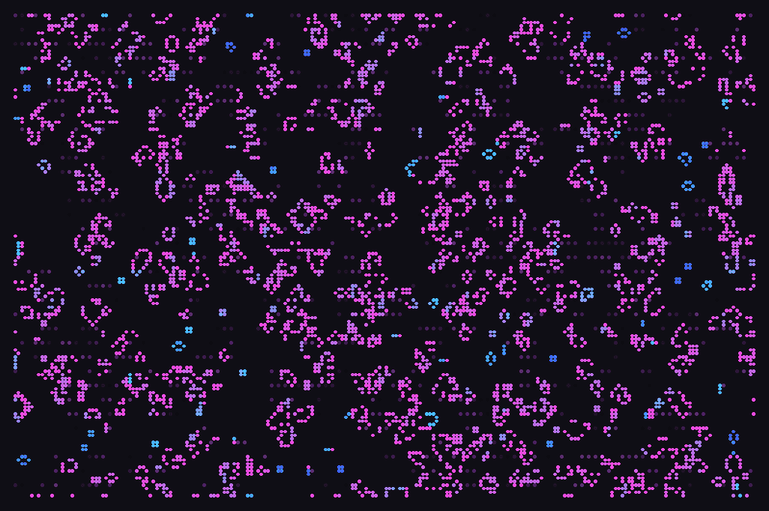
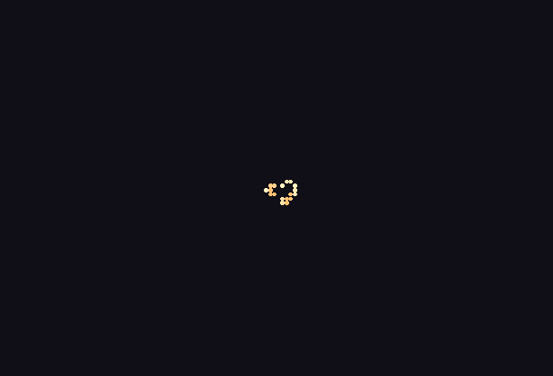
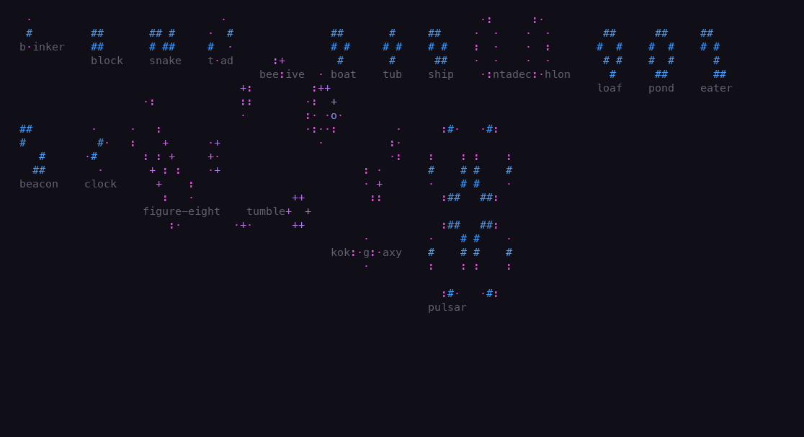
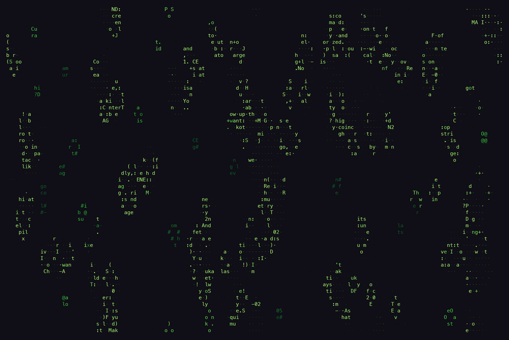
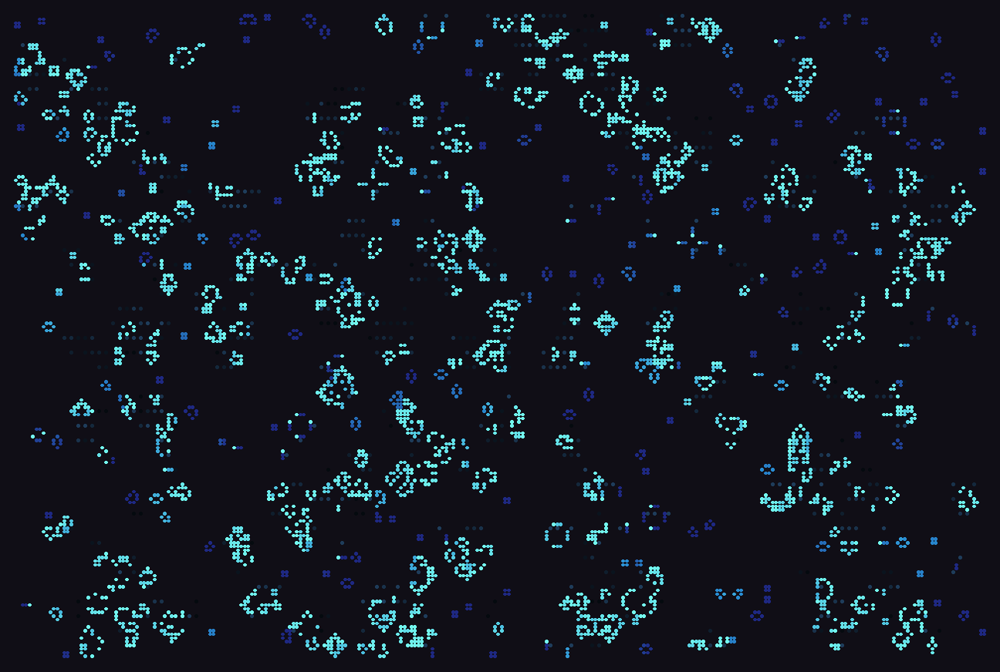

# ascii-game-of-life

A full-color, braille-based **Conway's Game of Life** for your terminal,
**written in Rust**: a living screensaver in the spirit of `asciiquarium` and
`cmatrix`. It boots straight into interesting structure, a curated library of
iconic Life forms (still lifes, oscillators, spaceships, a Gosper glider gun,
methuselahs), rather than random noise settling into a few blinkers.

**Pipe any text into it.** Living cells reveal the words underneath them, or
the words themselves are stamped into the world and come alive.

```sh
brew install pvbaudin/tap/ascii-game-of-life
tail -f app.log | life --text - --text-mode reveal
```

The command is `life`.



## Screenshots

| Methuselah: `life --scene methuselah --scheme ember` | Garden: `life --scene garden --glyphs --no-trails` |
|---|---|
|  |  |

| Text reveal: `life --text file.txt --text-mode reveal --scheme bio` | Fixed edges: `life --wrap off --scheme ocean` |
|---|---|
|  |  |

## Install

**Homebrew** (macOS and Linux):

```sh
brew install pvbaudin/tap/ascii-game-of-life
```

**Prebuilt binaries:** download a `.tar.gz` for macOS (Apple Silicon or Intel)
or Linux (x86_64 or arm64) from the
[latest release](https://github.com/pvbaudin/ascii-game-of-life/releases/latest),
unpack it, and put `life` on your PATH. On Debian/Ubuntu, install the `.deb`
instead:

```sh
sudo apt install ./ascii-game-of-life_*.deb
```

**From source** (needs a [Rust toolchain](https://rustup.rs)):

```sh
cargo install --git https://github.com/pvbaudin/ascii-game-of-life   # or, from a clone:
cargo install --path .
```

## Highlights

- **Braille renderer** (`U+2800`–`U+28FF`): every character packs a 2×4 grid of
  sub-pixels for 8× the resolution. There's a plainer glyph mode too (`·:+oO@#`).
  Despite the name, the default braille mode isn't technically ASCII: braille
  patterns are Unicode characters outside ASCII's 128. "ASCII" here is meant in
  the loose "ASCII art" sense.
- **Truecolor, background-transparent** output. Cells are colored by **age** —
  newborns one hue, elders another — with a fading **trail** for recently-dead
  cells. Five palettes: `neon`, `ember`, `bio`, `ocean`, `mono`.
- **Correct B3/S23**, double-buffered so a whole generation updates from the
  previous state.
- **Live resize** — reflows to the new terminal size without stretching or
  leaking, and restores the terminal on every exit path.
- **RLE pattern library** — patterns are embedded as standard LifeWiki RLE, so
  adding more is trivial.
- **Reactive text modes**: *reveal* (living cells reveal text beneath them) and
  *seed* (incoming words are stamped into the world as live cells that then
  evolve). Sources: text file, PDF, or live stdin. In reveal mode the source is
  word-wrapped to the terminal width and the window scrolls slowly down through
  it, **looping back to the top** at the end (a live stdin stream flows as a
  bottom-anchored tail instead); tune the rate with `--text-speed`.

## Scenes

- `garden` — a tidy, labeled showcase of the still lifes and oscillators.
- `soup` — a random field sprinkled with a Gosper gun and spaceships for
  constant motion (the default).
- `methuselah` — one small chaotic seed (R-pentomino / acorn / diehard) to watch
  evolve for hundreds of generations.

Cycle scenes / reseed at runtime with `r`.

## Edge model

The world is a **torus** by default (`--wrap on`): edges wrap, so the colony
never hits a wall and the scene feels endless — ideal for a screensaver. The
tradeoff is that patterns designed for the infinite plane behave differently on
a torus: a glider gun's stream eventually wraps around and collides with the
gun, and spaceships re-enter from the far side. To watch guns and spaceships
faithfully, use `--wrap off`, which makes the border fixed dead space so
escaping structures sail off and vanish. The world is exactly the viewport
resolution and reflows on resize; a larger off-screen world with a panning
camera is a natural future iteration.

## Controls

| Key | Action | | Key | Action |
|---|---|---|---|---|
| `q` / `Esc` / `Ctrl-C` | quit | | `+` / `-` | faster / slower |
| `space` | pause | | `c` | cycle color scheme |
| `.` | single-step | | `r` / `n` | reseed / next scene |
| | | | `m` | toggle mono |
| | | | `b` | toggle braille |

## CLI

```
life [OPTIONS]

  --fps, --speed <N>     generations per second (default 15)
  --scheme <NAME>        neon | ember | bio | ocean | mono
  --seed <N>             PRNG seed for reproducible soups
  --wrap <on|off>        toroidal edges (default on) or fixed dead border
  --scene <NAME>         garden | soup | methuselah
  --density <0..1>       soup fill fraction (default 0.28)
  --mono                 grayscale by age
  --braille | --glyphs   renderer (braille is default; 8× resolution)
  --no-trails            disable fading death-trails
  --text <FILE|->        text source ('-' = stdin) for text modes
  --text-mode <MODE>     reveal | seed
  --text-speed <N>       scroll/inject speed multiplier
```

### Headless harnesses (no terminal needed)

```
life --test              # invariant checks (blinker/glider/gun/…)
life --diag [N]          # population & per-frame change over N gens (TSV)
life --bench             # update+render cost across grid sizes, implied CPU%
life --snapshot [N]      # print one rendered frame after N gens
```

## Examples

```bash
life --scene garden --glyphs                 # labeled specimen garden
life --scene methuselah --scheme ember       # watch an acorn erupt
life --wrap off --density 0.3 --scheme ocean # gun & ships sail off-screen
tail -f app.log | life --text - --text-mode reveal   # log tail eaten by life
say-to-text | life --text - --text-mode seed         # words become gliders
life --text book.pdf --text-mode reveal --glyphs     # read a PDF, dissolving
```

## Build

```bash
cargo build --release      # binary at target/release/life
cargo run -- --help
```

Dependencies: `crossterm` (terminal), `libc` (the stdin fd-dup fix), and
`pdf-extract` (optional, default-on `pdf` feature; disable with
`--no-default-features` if you don't need PDF input).

## License

MIT. See [LICENSE](LICENSE).
